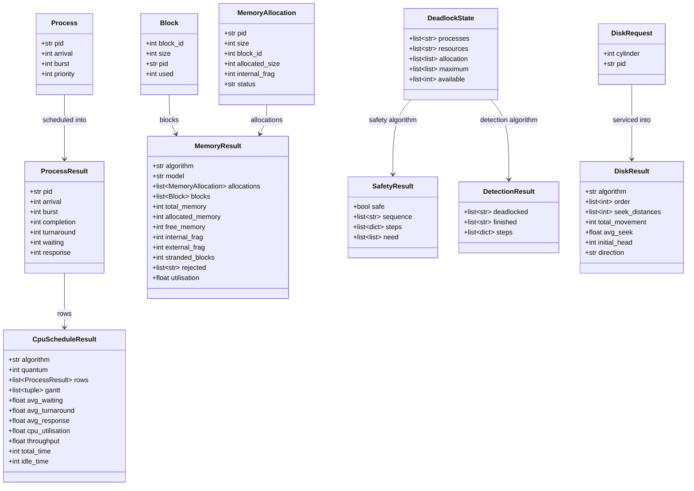
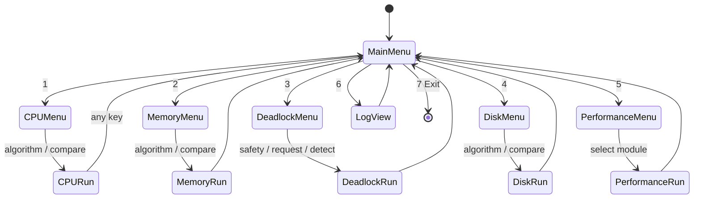

# Phase 1 — System Architecture and Diagrams
### OS Resource Management Simulator

Companion document to [`PHASE1_SYSTEM_DESIGN.md`](PHASE1_SYSTEM_DESIGN.md). This file contains the
architecture diagrams requested in Phase 1. Diagrams use Mermaid (rendered by GitHub and VS Code
with the Markdown Preview Mermaid extension) and plain ASCII (visible in any editor/terminal).

---

## 1. Context Diagram (Level 0)

Who talks to the system, and what leaves it.

```
                        ┌──────────────────────────────┐
                        │   OS Resource Management     │
   dataset (keyboard)   │         Simulator            │   results on screen
   menu choices ───────►│                              │───────────────►  Student / Examiner
   algorithm choice     │   Python 3 + Matplotlib      │
                        │                              │──► outputs/charts/*.png
   demo dataset files ─►│                              │──► outputs/reports/*.txt|.csv
   (data/*.txt)         │                              │──► outputs/logs/*.log
                        └──────────────────────────────┘
                                      ▲
                                      │ launch / test / clean
                              scripts/*.sh (Bash)
```

External dependencies: **Python 3.10+**, **Matplotlib** (optional at runtime — degrades gracefully),
**Bash** (Git Bash/WSL on Windows). Nothing else.

---

## 2. Layered Architecture

```
┌────────────────────────────────────────────────────────────────────────────┐
│ L4  PRESENTATION                                                            │
│     main.py                                                                 │
│     • main menu loop, sub-menus   • prompts & echo of datasets              │
│     • calls modules, prints tables, returns to menu on any outcome           │
└───────────────────────────────┬────────────────────────────────────────────┘
                                │  plain data in / result objects out
┌───────────────────────────────▼────────────────────────────────────────────┐
│ L3  APPLICATION / DOMAIN                                                    │
│     modules/cpu_scheduling.py      modules/disk_scheduling.py               │
│     modules/memory_management.py   modules/deadlock_management.py           │
│     modules/performance_analysis.py  (orchestrates L3 modules, no algos)     │
│     • pure functions: data → result dataclass                               │
│     • no input(), no print(), no file paths hard-coded                      │
└───────────────────────────────┬────────────────────────────────────────────┘
                                │  needs formatting, validation, logging
┌───────────────────────────────▼────────────────────────────────────────────┐
│ L2  SUPPORT / INFRASTRUCTURE                                                │
│     utils/validation.py       typed prompts + validators + ValidationError  │
│     utils/logger.py           timestamped session log                       │
│     utils/report_generator.py tables, CSV/MD reports, all Matplotlib charts │
└───────────────────────────────┬────────────────────────────────────────────┘
                                │  read / write
┌───────────────────────────────▼────────────────────────────────────────────┐
│ L1  DATA / PERSISTENCE                                                      │
│     data/*.txt                      demo datasets (read)                    │
│     outputs/charts/*.png            generated charts                        │
│     outputs/reports/*.txt|*.csv     generated tables                        │
│     outputs/logs/*.log              session logs                            │
└────────────────────────────────────────────────────────────────────────────┘
```

**Dependency rule:** arrows point downward only. `modules/` never imports `main.py`; `utils/` never
imports `modules/`. This is what makes each module importable and testable headlessly, and it is the
single most important design decision in the project.

---

## 3. File / Folder Structure (final target, annotated)

```
OS-Resource-Management-Simulator/
├── main.py                          # entry point: menu, prompts, screen output  [Phase 2]
├── requirements.txt                 # matplotlib                       (this phase)
├── .gitignore                       # ignores venv, outputs, caches     (this phase)
├── README.md                        # install/run/usage/samples          [Phase 5]
├── report.pdf                       # academic report                    [Phase 5]
│
├── modules/
│   ├── cpu_scheduling.py            # 5 CPU algorithms + metrics         [Phase 2]
│   ├── memory_management.py         # First/Best/Worst Fit + frag        [Phase 2]
│   ├── deadlock_management.py       # Banker's safety/request + detect   [Phase 2]
│   ├── disk_scheduling.py           # FCFS/SSTF/SCAN/C-SCAN             [Phase 2]
│   └── performance_analysis.py      # cross-algorithm comparisons        [Phase 3]
│
├── utils/
│   ├── validation.py                # all input checking                [Phase 2]
│   ├── logger.py                    # session logging                   [Phase 2]
│   └── report_generator.py          # tables, CSV/MD, charts            [Phase 2]
│
├── scripts/
│   ├── setup.sh                     # env checks + venv + deps           [Phase 2]
│   ├── run.sh                       # launch app from any directory     [Phase 2]
│   ├── test.sh                      # run unittest suite                [Phase 2]
│   └── clean.sh                     # remove generated artefacts        [Phase 2]
│
├── tests/
│   ├── test_cpu_scheduling.py                                        [Phase 4]
│   ├── test_memory_management.py                                     [Phase 4]
│   ├── test_deadlock_management.py                                   [Phase 4]
│   ├── test_disk_scheduling.py                                       [Phase 4]
│   └── test_validation.py                                            [Phase 4]
│
├── data/
│   ├── cpu_sample.txt  cpu_convoy.txt                                [Phase 2]
│   ├── memory_sample.txt                                             [Phase 2]
│   ├── deadlock_sample.txt                                           [Phase 2]
│   └── disk_sample.txt                                               [Phase 2]
│
├── outputs/                         # created at runtime if missing
│   ├── charts/                      # PNG charts
│   ├── reports/                     # comparison tables (.txt/.csv)
│   └── logs/                        # session_<timestamp>.log
│
├── screenshots/                     # real captures of the running app  [Phase 5]
├── docs/
│   ├── PHASE1_SYSTEM_DESIGN.md      # ← this phase
│   ├── PHASE1_ARCHITECTURE.md       # ← this phase
│   ├── PHASE3_ANALYSIS.md                                            [Phase 3]
│   ├── PHASE4_TEST_REPORT.md                                         [Phase 4]
│   └── PHASE5_ALGORITHM_GUIDE.md                                     [Phase 5]
└── .git/                            # version control
```

---

## 4. Component Diagram

```
                      ┌──────────────┐
                      │   main.py    │
                      └──────┬───────┘
        ┌────────────┬───────┼────────────┬──────────────────┐
        ▼            ▼       ▼            ▼                  ▼
 ┌────────────┐ ┌─────────┐ ┌───────────┐ ┌──────────────┐ ┌───────────────────┐
 │ cpu_       │ │ memory_ │ │ deadlock_ │ │ disk_        │ │ performance_      │
 │ scheduling │ │ manage- │ │ management│ │ scheduling   │ │ analysis          │
 │            │ │ ment    │ │           │ │              │ │ (calls all four)  │
 └─────┬──────┘ └────┬────┘ └─────┬─────┘ └──────┬───────┘ └─────────┬─────────┘
       │             │            │              │                   │
       └─────────────┴────────────┴──────────────┴───────────────────┘
                                      │
              ┌───────────────────────┼────────────────────────┐
              ▼                       ▼                        ▼
     ┌────────────────┐     ┌─────────────────┐      ┌──────────────────┐
     │ report_        │     │ logger.py       │      │ validation.py    │
     │ generator.py   │     │                 │      │ (used by main    │
     │ (tables,charts)│     │                 │      │  and by modules  │
     └───────┬────────┘     └────────┬────────┘      │  for defence)    │
             │                       │               └──────────────────┘
             ▼                       ▼
     outputs/charts/*.png    outputs/logs/*.log
     outputs/reports/*.txt|.csv
```

`performance_analysis.py` deliberately contains **no** scheduling/allocation logic: it imports the
module functions and only compares their results. One implementation of each algorithm, used by
both a single run and a comparison run, guarantees that numbers never disagree.

---

## 5. Data Model (class diagram)



ASCII summary of the same relationships:

```
Process ──► [CPU algorithm] ──► CpuScheduleResult ─┐
                                                  ├─► [report_generator] ──► screen / files
Block   ──► [Memory algorithm] ► MemoryResult ────┤
DeadlockState ► [Banker's/detect] ► SafetyResult ─┤
DiskRequest   ► [Disk algorithm] ► DiskResult ────┘
                                                   └─► [performance_analysis] ──► comparison table
```

---

## 6. Sequence Diagram — "compare all CPU algorithms"

```
Student            main.py          validation.py     cpu_scheduling.py    report_gen     logger
   │                  │                   │                  │                 │            │
   │ "5 Performance"  │                   │                  │                 │            │
   ├─────────────────►│                   │                  │                 │            │
   │                  │ choose module=CPU │                  │                 │            │
   │ ◄── prompt ──────┤                   │                  │                 │            │
   │ "1 demo dataset" │                   │                  │                 │            │
   ├─────────────────►│ read data/cpu_sample.txt            │                 │            │
   │                  │                   │                  │                 │            │
   │                  │ validate_processes()                 │                 │            │
   │                  ├──────────────────►│                  │                 │            │
   │                  │   OK / ValidationError               │                 │            │
   │                  │◄──────────────────┤                  │                 │            │
   │                  │ fcfs / sjf / srtf / priority / rr    │                 │            │
   │                  ├─────────────────────────────────────►│                 │            │
   │                  │◄── 5 × CpuScheduleResult ────────────┤                 │            │
   │                  │ compare(results)  → best per metric   │                 │            │
   │                  │ render_table() + save_report() + plot │                 │            │
   │                  ├─────────────────────────────────────────────────────►  │            │
   │                  │◄──────── file paths ────────────────────────────────── |            │
   │ ◄── table+chart ─┤ log_event("CPU","COMPARE", summary)                │                 │
   │                  ├──────────────────────────────────────────────────────────────────►  │
   │                  │ back to main menu                                     │            │
```

---

## 7. Menu Navigation (state diagram)



ASCII:

```
            ┌──────────────────────── MAIN MENU (loop) ────────────────────────┐
            │ 1 CPU   2 Memory   3 Deadlock   4 Disk   5 Analysis  6 Logs  7 Exit│
            └───┬──────────┬───────────┬────────────┬─────────┬────────┬───────┘
                ▼          ▼           ▼            ▼         ▼        ▼
          sub-menu   sub-menu     sub-menu     sub-menu   module    last 20
          algorithm  algorithm    safety /     algorithm  picker    log lines
          + data     + data       request /    + data        │
                │          │       detect          │          │
                └──────────┴───────────┴───────────┴──────────┘
                                        │
                                  run + print + log
                                        │
                                        └──────► back to MAIN MENU
```

Invalid choice → one-line error → menu redisplayed (FR-1.2). `7` → clean exit (log flushed, files
closed).

---

## 8. Data Flow Diagram (Level 1) — where numbers come from

```
 ┌────────┐  raw text   ┌─────────────┐  typed ints/lists  ┌──────────────────┐
 │  User  │────────────►│ validation  │───────────────────►│  module function │
 └────────┘             │  .py        │                    │  (algorithm)     │
      ▲                 └─────┬───────┘                    └────────┬─────────┘
      │                       │ ValidationError                   │ result object
      │ error message         ▼                                   ▼
      │                 ┌───────────┐                    ┌────────────────────┐
      └─────────────────│  main.py  │◄───────────────────│ metrics computed   │
                        │ (display) │   formatted table  │ inside the module  │
                        └─────┬─────┘                    └─────────┬──────────┘
                              │                                    │
                              │                                    ▼
                              │                          ┌────────────────────┐
                              │                          │ report_generator   │
                              │                          │ • table → stdout   │
                              │                          │ • .txt/.csv        │
                              │                          │ • matplotlib PNG   │
                              │                          └─────────┬──────────┘
                              │                                    │
                              └──────────── log line ──────────────┴──► outputs/logs/
```

Note the deliberate split: **metrics are computed inside the module** (domain logic), while
**formatting happens in `report_generator`**. Tests therefore assert on numbers, not on strings.

---

## 9. Runtime / Deployment View

```
 Development (VS Code)                      Execution (any machine)
 ┌─────────────────────┐                   ┌───────────────────────────────┐
 │  src/ (git repo)    │  git clone        │  python3 main.py              │
 │  main.py modules/   │──────────────────►│  or ./scripts/run.sh          │
 │  utils/ tests/      │                   │  ┌─────────────────────────┐  │
 └─────────────────────┘                   │  │ venv (optional)         │  │
                                           │  │  matplotlib installed   │  │
                                           │  └─────────────────────────┘  │
                                           └───────────────┬───────────────┘
                                                           │ writes only here
                                                           ▼
                                              outputs/{charts,reports,logs}/
```

Bash script responsibilities (each does real work — no echo-only stubs):

| Script | Real actions |
|---|---|
| `setup.sh` | checks `python3` version ≥ 3.10, checks `pip`, creates `.venv` if absent, installs `requirements.txt`, creates `outputs/` and `data/` folders with permissions, prints a readiness summary and the exact run command |
| `run.sh` | locates the repo root relative to itself (works from any directory), activates `.venv` if present, verifies dependencies, starts `main.py`, returns its exit code |
| `test.sh` | activates venv if present, runs `python3 -m unittest discover -s tests -v`, prints a pass/fail summary and propagates a non-zero exit code on failure |
| `clean.sh` | deletes generated charts/reports/logs and `__pycache__`, asks for confirmation (`--force` to skip), and **never** deletes `data/` or source |

---

## 10. Error-Handling Strategy (cross-cutting)

```
user input ──► parse ──► range/domain check ──► algorithm
                 │              │
                 │ bad type     │ bad value
                 ▼              ▼
            ValidationError(message) ──► main.py: print "✗ " + message ──► re-prompt
                                            │
                                            └──► logger.log_error(...)

algorithm ──► unexpected exception ──► main.py top-level try/except
                                            ├── print short message (no traceback)
                                            └── log full traceback to outputs/logs/
```

Three layers, so a bug in one module cannot kill the session: (1) validators stop bad data early,
(2) modules raise `ValueError` for domain violations they still detect, (3) the menu loop catches
everything, logs the traceback and returns to the menu. This satisfies NFR-2 and is exactly what
Phase 4 tests.

---

## 11. Architectural Decisions and Trade-offs

| Decision | Alternative considered | Why chosen |
|---|---|---|
| Pure functions returning dataclasses | Classes with `run()` methods holding state | Simpler to test, no shared state between runs, easy to compare algorithm outputs |
| Terminal UI | Flask/web UI | Requirement is terminal; no dependency, works in a viva without browser/network |
| Plain-text datasets | SQLite/JSON | Inspectable, editable, diff-friendly, zero dependencies |
| Gantt as segment list | Per-process (start, end) pair | Preemption produces multiple slices; idle gaps must be represented |
| Matplotlib imported lazily | Hard import at top | App still works (text-only) where Matplotlib is missing (FR-7.6) |
| Two memory models | One model with unclear fragmentation | Fragmentation is definition-sensitive; two clearly-labelled models are academically defensible |
| `unittest` | pytest | Standard library only; no extra install; explicitly required |
| One `outputs/` tree | Scatter files next to source | `clean.sh` can safely wipe generated data; repository stays tidy |

---

## 12. Summary of Phase 1 Architecture

* Five layers with a strict one-way dependency rule.
* One file per responsibility; `main.py` is the only file that touches `stdin`.
* One shared result contract per module, enabling both single runs and comparisons.
* All output artefacts confined to `outputs/`, all inputs in `data/`.
* Three-layer error handling and a log for every run.
* Bash tooling limited to four small, purposeful scripts.

With this architecture, Phase 2 can be implemented module by module, and every module is verifiable
from a Python one-liner or a unit test — which is precisely how the remaining 80 marks are earned.
